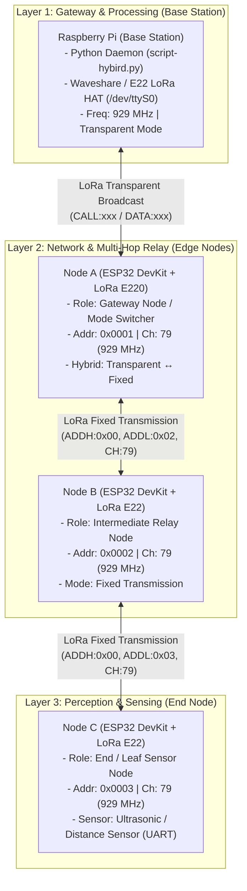
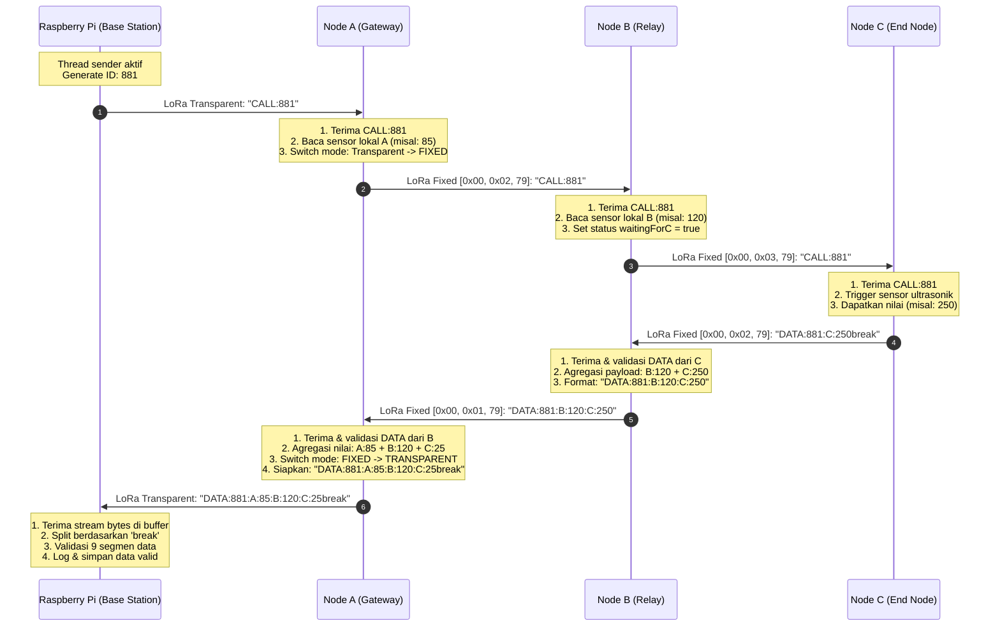

# Flood Early Warning System (FEWS) - LoRa Multi-Node Network

Dokumentasi sistem komunikasi nirkabel berbasis LoRa untuk monitoring sensor multi-node menggunakan topologi *multi-hop linear* (daisy-chain). Sistem ini mengintegrasikan **Raspberry Pi** sebagai *Base Station / Central Gateway*, serta **Node A, Node B, dan Node C** berbasis **ESP32 DevKit** dan modul **LoRa Ebyte E22 / E220 (900T22D)**.

---

## Daftar Isi
1. [Ikhtisar Sistem](#1-ikhtisar-sistem)
2. [Arsitektur Sistem](#2-arsitektur-sistem)
3. [Topologi Jaringan](#3-topologi-jaringan)
4. [Spesifikasi Node & Skema Wiring](#4-spesifikasi-node--skema-wiring)
   - [Skema Wiring Resistor Pull-Up RX/TX](#skema-wiring-resistor-pull-up-rxtx)
   - [Tabel Pinout ESP32 ke Modul LoRa](#tabel-pinout-esp32-ke-modul-lora)
5. [Protokol Komunikasi Jaringan](#5-protokol-komunikasi-jaringan)
   - [Parameter Fisik LoRa](#parameter-fisik-lora)
   - [Mekanisme Transmisi Hybrid](#mekanisme-transmisi-hybrid)
   - [Struktur Paket Data](#struktur-paket-data)
   - [Manajemen Timeout & Error Handling](#manajemen-timeout--error-handling)
6. [Alur Flow Paket Data (End-to-End)](#6-alur-flow-paket-data-end-to-end)
   - [Sequence Diagram](#sequence-diagram)
   - [Penjelasan Detail Per Fase](#penjelasan-detail-per-fase)
7. [Panduan Konfigurasi dan Penggunaan](#7-panduan-konfigurasi-dan-penggunaan)

---

## 1. Ikhtisar Sistem

Sistem ini dirancang untuk pemantauan lingkungan dan peringatan dini banjir (*Flood Early Warning System*) di area linear (seperti sepanjang aliran sungai atau drainase). Karena jarak jangkau yang panjang dan kemungkinan adanya halangan geografis (*Non-Line-of-Sight*), sistem menggunakan relai bertingkat (*multi-hop relay*) dengan arsitektur transmisi hybrid (kombinasi *Transparent Transmission* dan *Fixed Transmission*).

- **Raspberry Pi (Base Station / Node 0):** Memulai siklus polling (*CALL*) secara berkala dan menerima paket data agregat akhir (*DATA*).
- **Node A (Gateway / Relay Node):** Menerima *CALL* transparan dari Raspberry Pi, membaca sensor lokal A, berganti ke mode *Fixed* untuk memanggil Node B, mengumpulkan data, dan mengirimkan hasil gabungan kembali ke Raspberry Pi secara transparan.
- **Node B (Relay Node):** Menerima pesan *Fixed CALL* dari Node A, membaca sensor lokal B, meneruskan *Fixed CALL* ke Node C, menerima data C, menggabungkan data B + C, dan mengirimkannya kembali ke Node A.
- **Node C (Leaf / End Sensor Node):** Menerima *Fixed CALL* dari Node B, membaca sensor (misalnya sensor jarak/ultrasonik UART), dan membalas dengan paket data C ke Node B.

---

## 2. Arsitektur Sistem

Arsitektur sistem terdiri dari 3 lapisan utama (*Perception Layer*, *Network & Relay Layer*, dan *Gateway / Application Layer*):



### Peran Setiap Komponen:
1. **Raspberry Pi (Base Station):**
   - Menjalankan multi-threading: thread `sender` (mengirim *polling request* setiap 15 detik) dan thread `receiver` (mendengarkan respons paket data secara terus-menerus).
   - Memvalidasi integritas paket data yang diakhiri pembatas `break`.
2. **Node A (Node Gateway Jaringan LoRa):**
   - Menjembatani siaran transparan dari Base Station dengan jaringan internal bertarget (*fixed addressed*).
   - Mengubah mode register E220 secara dinamis (*Dynamic Mode Switching*): *Transparent* saat *idle/mendengarkan Pi* $\rightarrow$ *Fixed* saat berkomunikasi dengan Node B $\rightarrow$ *Transparent* saat mengirim data final ke Pi.
3. **Node B (Node Repeater / Relay Perantara):**
   - Beroperasi secara permanen dalam mode *Fixed Transmission*.
   - Mencegah tumbukan paket (*packet collision*) dengan mengontrol alur pengiriman data dari Node C ke Node A.
4. **Node C (Node Sensor Ujung):**
   - Membaca sensor fisik (UART distance sensor / level air) hanya saat menerima sinyal permintaan (*on-demand sensing*), menghemat daya operasional.

---

## 3. Topologi Jaringan

Topologi yang diterapkan adalah **Topologi Linear Multi-Hop** (*Chain / Daisy-Chain Topology*).

```
[ Raspberry Pi ] 
       ↕ (Transparent Wireless LoRa Link)
   [ Node A ] (Addr: 0x0001, CH: 79)
       ↕ (Fixed Point-to-Point LoRa Link)
   [ Node B ] (Addr: 0x0002, CH: 79)
       ↕ (Fixed Point-to-Point LoRa Link)
   [ Node C ] (Addr: 0x0003, CH: 79)
```

### Matriks Pengalamatan & Kanal Node

| Identitas Node | Hardware | Alamat (ADDH / ADDL) | Saluran (CHAN) | Frekuensi Dasar | Mode Transmisi |
| :--- | :--- | :--- | :--- | :--- | :--- |
| **Raspberry Pi** | RPi + LoRa HAT | Addr: 1 (0x0001) | 79 | 929.125 MHz | Transparent |
| **Node A** | ESP32 + E220-900T22D | `0x00` / `0x01` | 79 | 929.125 MHz | Hybrid (Transp. $\leftrightarrow$ Fixed) |
| **Node B** | ESP32 + E22-900T22D | `0x00` / `0x02` | 79 | 929.125 MHz | Fixed Transmission |
| **Node C** | ESP32 + E22-900T22D | `0x00` / `0x03` | 79 | 929.125 MHz | Fixed Transmission |

### Alasan Pemilihan Topologi Linear:
1. **Karakteristik Geografis Daerah Aliran Sungai (DAS):** Node pemantauan ketinggian air dipasang berurutan di sepanjang bantaran sungai dengan jarak antar-node yang saling berjauhan.
2. **Efisiensi Daya & Jangkauan:** Node C tidak memerlukan daya pancar tinggi untuk menembus langsung ke Raspberry Pi karena beban transmisi dibagi melalui Node B dan Node A.
3. **Mencegah Tabrakan Paket (Collision Avoidance):** Aliran token *CALL-DATA* bergiliran menjamin hanya ada satu node yang memancarkan sinyal aktif pada satu waktu dalam saluran yang sama.

---

## 4. Spesifikasi Node & Skema Wiring

### Karakteristik Modul Ebyte E22 / E220
Modul LoRa E22 / E220 menggunakan chip Semtech SX1262 / SX1268 dengan antarmuka UART level tegangan logika 3.3V TTL. 

### Skema Wiring Resistor Pull-Up RX/TX

> [!IMPORTANT]
> **Pentingnya Resistor Pull-Up:**
> Jalur UART pada mikrokontroler (ESP32) dan pin TXD/RXD modul LoRa Ebyte E22/E220 bertipe *open-collector/TTL*. Saat ESP32 melakukan booting, reset, atau saat modul E22 berganti mode transmisi (*sleep/config/normal*), jalur serial dapat berada dalam kondisi *floating* (mengambang). Kondisi ini rentan terhadap gangguan induksi elektro-magnetik yang menyebabkan *framing error* atau munculnya karakter sampah (*garbage bytes*).
> 
> Dengan menambahkan **resistor pull-up eksternal sebesar 4.7 kΩ s/d 10 kΩ ke VCC (3.3V)** pada jalur **RX** dan **TX**, jalur data dipertahankan pada status logika HIGH (kondisi *IDLE* standar UART), sehingga transfer data stabil dan bersih dari *glitch*.

```
                      +3.3V (ESP32 / Power Rail)
                         │               │
                       [4.7k -         [4.7k -
                        10k Ω]          10k Ω]
                         │               │
                         ├───────────────┼────────────────┐
                         │               │                │
    ┌──────────────┐     │               │     ┌──────────────────────┐
    │              │     │               │     │                      │
    │   ESP32      │     │               │     │   LoRa E22 / E220    │
    │   DEVKIT     │     │               │     │   (900T22D)          │
    │              │     │               │     │                      │
    │  GPIO 16/32  ├─────┴───────────────┼─────┤ TXD                  │
    │  (UART RX2)  │ (ESP32 menerima data)     │                      │
    │              │                             │                      │
    │  GPIO 17/33  ├─────────────────────┴─────┤ RXD                  │
    │  (UART TX2)  │ (ESP32 mengirim data)     │                      │
    │              │                             │                      │
    │  GPIO 21     ├───────────────────────────┤ AUX                  │
    │  GPIO 22     ├───────────────────────────┤ M0                   │
    │  GPIO 23     ├───────────────────────────┤ M1                   │
    │              │                             │                      │
    │  3.3V / 5V   ├───────────────────────────┤ VCC                  │
    │  GND         ├───────────────────────────┤ GND                  │
    └──────────────┘                           └──────────────────────┘
```

### Tabel Pinout ESP32 ke Modul LoRa

#### 1. Node A (ESP32 DevKit + E220-900T22D)
| Pin E220 | Pin ESP32 | Keterangan & Catatan Wiring |
| :--- | :--- | :--- |
| **VCC** | 3.3V / 5V | Sumber daya modul (disarankan arus stabil $\ge 500\text{ mA}$) |
| **GND** | GND | Common Ground |
| **TXD** | **GPIO 16** (RX2) | Dihubungkan dengan **Resistor Pull-Up 4.7kΩ / 10kΩ ke 3.3V** |
| **RXD** | **GPIO 17** (TX2) | Dihubungkan dengan **Resistor Pull-Up 4.7kΩ / 10kΩ ke 3.3V** |
| **AUX** | **GPIO 21** | Status modul (Busy/Idle indication) |
| **M0** | **GPIO 22** | Kontrol Mode Operasi Bit 0 |
| **M1** | **GPIO 23** | Kontrol Mode Operasi Bit 1 |

#### 2. Node B (ESP32 DevKit + E22-900T22D)
| Pin E22 | Pin ESP32 | Keterangan & Catatan Wiring |
| :--- | :--- | :--- |
| **VCC** | 3.3V / 5V | Sumber daya modul |
| **GND** | GND | Common Ground |
| **TXD** | **GPIO 16** (RX2) | Dihubungkan dengan **Resistor Pull-Up 4.7kΩ / 10kΩ ke 3.3V** |
| **RXD** | **GPIO 17** (TX2) | Dihubungkan dengan **Resistor Pull-Up 4.7kΩ / 10kΩ ke 3.3V** |
| **AUX** | **GPIO 21** | Status modul |
| **M0** | **GPIO 22** | Kontrol Mode Operasi Bit 0 |
| **M1** | **GPIO 23** | Kontrol Mode Operasi Bit 1 |

*(Catatan: Pada konfigurasi alternatif `lora_configuration_node-b.ino`, pin serial dapat dialokasikan ke GPIO 32 (RXD2) dan GPIO 33 (TXD2)).*

#### 3. Node C (ESP32 DevKit + E22-900T22D + Sensor Ultrasonik)
| Pin Komponen | Pin ESP32 | Keterangan & Catatan Wiring |
| :--- | :--- | :--- |
| **LoRa VCC** | 3.3V / 5V | Sumber daya modul LoRa |
| **LoRa GND** | GND | Common Ground |
| **LoRa TXD** | **GPIO 32** (RX2) | Dihubungkan dengan **Resistor Pull-Up 4.7kΩ / 10kΩ ke 3.3V** |
| **LoRa RXD** | **GPIO 33** (TX2) | Dihubungkan dengan **Resistor Pull-Up 4.7kΩ / 10kΩ ke 3.3V** |
| **LoRa AUX** | **GPIO 21** | Status modul |
| **LoRa M0** | **GPIO 22** | Kontrol Mode Operasi Bit 0 |
| **LoRa M1** | **GPIO 23** | Kontrol Mode Operasi Bit 1 |
| **Sensor Power** | **GPIO 27** | Saklar daya sensor (opsional penghemat daya) |
| **Sensor TX** | **GPIO 25** (RX1) | Jalur data UART penerima dari sensor jarak |
| **Sensor RX** | **GPIO 26** (TX1) | Jalur data UART pengirim instruksi ke sensor |

---

## 5. Protokol Komunikasi Jaringan

### Parameter Fisik LoRa

Pengaturan register pada Ebyte E22 / E220 diseragamkan pada seluruh node:

| Parameter | Nilai Register | Deskripsi |
| :--- | :--- | :--- |
| **Frekuensi Operasi** | `CH = 79` | $850\text{ MHz} + 79 = \mathbf{929.125\text{ MHz}}$ |
| **UART Baudrate** | `9600 bps` | Format 8N1 (8 Data bits, No Parity, 1 Stop bit) |
| **Air Data Rate** | `2.4 kbps` | Kecepatan modulasi LoRa di udara (optimal untuk jangkauan jauh) |
| **Sub-packet Setting** | `200 / 240 Bytes` | Ukuran buffer transmisi maksimum per paket |
| **Transmission Power**| `22 dBm` (~160 mW) | Daya pancar maksimal untuk daya tembus optimal |
| **LBT & RSSI Noise** | `Disabled` | Pengurangan beban komputasi modul |

### Mekanisme Transmisi Hybrid

1. **Transparent Transmission Mode:**
   - Semua data yang ditulis ke serial akan langsung dipancarkan tanpa alamat tujuan.
   - Digunakan oleh **Raspberry Pi** untuk mengirim polling siaran dan **Node A** untuk mengirimkan data agregat kembali ke Base Station.
2. **Fixed Transmission Mode:**
   - Paket data harus diawali 3 byte header: `[Target ADDH] [Target ADDL] [Target CHAN] [Payload...]`.
   - Modul penerima yang memiliki alamat dan kanal yang sesuai akan mengekstrak `[Payload...]` dan membuang 3 byte header secara otomatis di level hardware.
   - Digunakan pada komunikasi antar-node: **Node A $\leftrightarrow$ Node B $\leftrightarrow$ Node C**.

### Struktur Paket Data

Pemisah field menggunakan karakter titik dua (`:`), dan terminator paket menggunakan string penutup `break`.

#### 1. Paket Permintaan Polling (*CALL Packet*)
Dikirim dari Base Station (Pi) ke Node A, diteruskan Node A ke Node B, dan diteruskan Node B ke Node C:
```text
CALL:<REQUEST_ID>
```
*Contoh:*
```text
CALL:881
```

#### 2. Paket Data Sensor Node C (*Leaf Response*)
Dikirim dari Node C ke Node B (Fixed Transmission):
```text
DATA:<REQUEST_ID>:C:<NILAI_C>break
```
*Contoh:*
```text
DATA:881:C:250break
```

#### 3. Paket Data Agregat Node B (*Relay Response*)
Dikirim dari Node B ke Node A (Fixed Transmission):
```text
DATA:<REQUEST_ID>:B:<NILAI_B>:C:<NILAI_C>
```
*Contoh:*
```text
DATA:881:B:120:C:250
```

#### 4. Paket Data Final Node A (*Gateway to Base Station*)
Dikirim dari Node A ke Raspberry Pi (Transparent Transmission):
```text
DATA:<REQUEST_ID>:A:<NILAI_A>:B:<NILAI_B>:C:<NILAI_C>break
```
*Contoh:*
```text
DATA:881:A:85:B:120:C:25break
```

### Manajemen Timeout & Error Handling

Untuk memastikan jaringan tidak mengalami *deadlock* saat salah satu node mengalami kehilangan sinyal atau kegagalan perangkat keras:

- **Node A Collection Timeout (15.000 ms):** Jika Node B tidak mengembalikan data dalam 15 detik, Node A tetap mengirimkan data yang berhasil diperoleh (data parsial) ke Raspberry Pi dan kembali ke mode siaga (*IDLE*).
- **Node B Timeout (10.000 ms):** Jika Node C tidak merespons dalam 10 detik, Node B mengirimkan datanya sendiri ke Node A.
- **Overlap Protection:** Flag `collecting` (Node A) dan `waitingForC` (Node B) mengabaikan pesan `CALL` baru selama proses siklus pengumpulan data yang sedang berlangsung belum selesai.
- **Validasi Request ID:** Paket data yang memiliki `REQUEST_ID` tidak sesuai dengan siklus saat ini akan ditolak untuk menghindari pencampuran data lampau.

---

## 6. Alur Flow Paket Data (End-to-End)

Berikut adalah diagram alir lengkap pengiriman paket mulai dari Raspberry Pi diinisiasi hingga paket hasil kembali diterima oleh Raspberry Pi:

### Sequence Diagram



### Penjelasan Detail Per Fase

1. **Fase Inisiasi (Raspberry Pi $\rightarrow$ Node A):**
   - Thread `sender` pada `script-hybird.py` menghasilkan request ID unik: `msg = f"CALL:88{n}"`.
   - Modul LoRa Raspberry Pi memancarkan data secara transparan pada frekuensi 929.125 MHz.
   - Node A yang berada dalam keadaan *IDLE* dan mode *Transparent* menangkap sinyal ini.

2. **Fase Pemrosesan & Pergantian Mode di Node A:**
   - Node A memeriksa ketersediaan data serial LoRa melalui `e220ttl.available()`.
   - Memeriksa prefix string `CALL:`. Jika valid, fungsi `startCollection(requestId)` dipanggil.
   - Membaca sensor lokal A (`readSensorA()`).
   - Melakukan konfigurasi ulang register E220 pada runtime via `changeTransmissionMode(MODE_FIXED)`.
   - Mengirim pesan `CALL:88{n}` secara *Fixed Transmission* dengan target Alamat `0x0002` (Node B) pada Kanal `79`.

3. **Fase Relai di Node B (Node A $\rightarrow$ Node B $\rightarrow$ Node C):**
   - Node B menerima paket melalui transmisi terarah. Modul E22 mencocokkan alamat `0x0002` dan menyajikan payload ke serial ESP32.
   - Node B membaca sensor lokal B (`readSensorB()`).
   - Menyimpan nilai sensor B secara lokal dalam string `dataB`.
   - Mengirimkan pesan `CALL:88{n}` secara *Fixed Transmission* dengan target Alamat `0x0003` (Node C) pada Kanal `79`.
   - Mengaktifkan timer `waitStart = millis()` dan status `waitingForC = true`.

4. **Fase Pengukuran Sensor di Node C (Node C $\rightarrow$ Node B):**
   - Node C menerima instruksi `CALL:88{n}`.
   - Menjalankan fungsi `readSensorOnDemand()` melalui komunikasi serial UART hardware ke sensor ultrasonik (GPIO 25 & 26).
   - Membungkus hasil pengukuran ke format: `DATA:88{n}:C:<nilai>break`.
   - Mengirimkan paket balasan secara *Fixed Transmission* kembali ke Alamat `0x0002` (Node B).

5. **Fase Agregasi Data di Node B (Node B $\rightarrow$ Node A):**
   - Node B menerima paket balasan dari Node C.
   - Memvalidasi bahwa tipe paket adalah `DATA`, request ID sesuai dengan `currentRequestId`, dan pengirim adalah `C`.
   - Menggabungkan data sensor B dan data sensor C ke format:
     `DATA:<REQUEST_ID>:B:<valB>:C:<valC>`.
   - Mengirimkan paket kombinasi ke Alamat `0x0001` (Node A) pada Kanal `79`.
   - Menonaktifkan flag `waitingForC = false`.

6. **Fase Finalisasi & Pelaporan ke Base Station (Node A $\rightarrow$ Raspberry Pi):**
   - Node A menerima paket gabungan dari Node B, memparsing nilai data B dan C.
   - Menggabungkan seluruh data menjadi paket final:
     `DATA:<REQUEST_ID>:A:<valA>:B:<valB>:C:<valC>break`.
   - Mengubah kembali mode operasi modul E220 ke `MODE_TRANSPARENT`.
   - Mengirimkan paket final secara transparan ke udara sehingga dapat diterima oleh Raspberry Pi Base Station.
   - Mereset status `collecting = false` dan kembali ke mode *IDLE*.

7. **Fase Dekomposisi & Pencatatan di Raspberry Pi:**
   - Thread `receiver` di Raspberry Pi membaca byte serial dari `/dev/ttyS0` dan memasukkannya ke `rx_buffer`.
   - Ketika terdeteksi penanda batas `break`, buffer dipotong dan diurai menggunakan pemisah `:`.
   - Dilakukan validasi jumlah elemen (`len(parts) == 9`), jenis paket (`DATA`), dan pengirim (`A`).
   - Data berhasil diverifikasi dan dicatat bersama *timestamp* sistem.

---

## 7. Panduan Konfigurasi dan Penggunaan

### 1. Konfigurasi Awal Parameter Register Modul LoRa
Sebelum menjalankan program utama, lakukan konfigurasi permanen (*WRITE_CFG_PWR_DWN_SAVE*) pada masing-masing node menggunakan sketch konfigurasi yang telah disediakan:
- **Node A:** Buka dan flash [`lora_configuration_node-a/lora_configuration_node-a.ino`]
- **Node B:** Buka dan flash [`lora_configuration_node-b/lora_configuration_node-b.ino`]
- **Node C:** Buka dan flash [`lora_configuration_node-c/lora_configuration_node-c.ino`]

### 2. Upload Firmware Node Utama
Setelah konfigurasi register tersimpan:
1. Flash program utama Node A: [`lora_node-a/lora_node-a.ino`]
2. Flash program utama Node B: [`lora_node-b/lora_node-b.ino`]
3. Flash program utama Node C: [`lora_node-c/lora_node-c.ino`]

### 3. Menjalankan Gateway Raspberry Pi
1. Pastikan antarmuka serial hardware UART `/dev/ttyS0` pada Raspberry Pi telah aktif (`raspi-config` $\rightarrow$ Interface Options $\rightarrow$ Serial Port $\rightarrow$ Login shell disabled, Hardware port enabled).
2. Install dependensi Python:
   ```bash
   pip3 install pyserial RPi.GPIO
   ```
3. Jalankan script gateway hybrid:
   ```bash
   python3 script-hybird.py
   ```
4. Output log pada console Raspberry Pi akan menampilkan polling periodik dan data yang berhasil dikumpulkan:
   ```text
   [Node 0]: Sender ready
   [Node 0]: Receiver ready
   [Node 0]: SENT CALL:881
   receive something
   RAW: DATA:881:A:45:B:210:C:32
   ================================
   VALID DATA
   Packet ID: 881
   Node A: A   45
   Node B: B   210
   Node C: C   32
   TIME: 2026-10-24 19:15:00
   ================================
   ```
